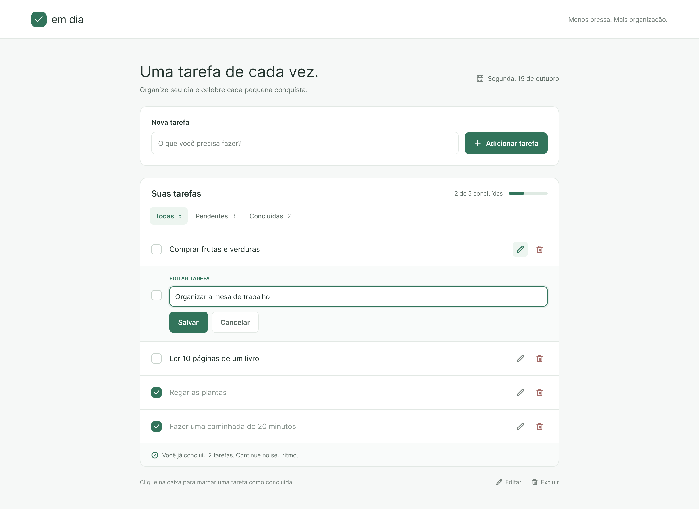

# em dia — Teste prático (Desenvolvedor Jr)

Aplicação de lista de tarefas. O ambiente já está pronto: banco conectado, API respondendo com dados mockados e front-end rodando. O seu trabalho é fazer tudo funcionar de verdade.

- **Design (Figma):** https://www.figma.com/design/50gzDTlyEIYKHKDEysbn7Y/Untitled?node-id=2-104&t=MTjROjmWvCHMzPFT-1
- **Referência da tela:** [docs/referencia-ui.png](docs/referencia-ui.png)



## Stack

| Camada    | Tecnologias                                  |
| --------- | -------------------------------------------- |
| Backend   | Node 22, TypeScript, Fastify, Prisma, Vitest |
| Frontend  | React, TypeScript, Vite                      |
| Banco     | PostgreSQL 16                                |
| Qualidade | ESLint + Prettier (nos dois projetos)        |

## Como rodar

Pré-requisito: Docker com Docker Compose.

```bash
cp .env.example .env
docker compose up --build
```

| Serviço  | URL                                |
| -------- | ---------------------------------- |
| Frontend | http://localhost:5173              |
| Backend  | http://localhost:3333              |
| Health   | http://localhost:3333/health       |
| Postgres | localhost:5432 (`emdia` / `emdia`) |

O backend aplica as migrations ao subir. Os dois projetos rodam com hot reload.

O front chama a API pelo prefixo `/api` (proxy do Vite): `fetch('/api/tasks')` chega em `GET /tasks` no backend.

### Rodando fora do Docker (opcional)

```bash
docker compose up -d db

cd backend
cp .env.example .env
npm install
npx prisma migrate deploy
npm run dev

cd ../frontend
npm install
npm run dev
```

## Scripts

Em `backend/` e `frontend/`:

| Script                 | O que faz                    |
| ---------------------- | ---------------------------- |
| `npm run dev`          | Sobe em modo desenvolvimento |
| `npm run lint`         | ESLint                       |
| `npm run format`       | Formata com Prettier         |
| `npm run format:check` | Verifica formatação          |
| `npm run typecheck`    | Checagem de tipos            |
| `npm run build`        | Build de produção            |

Somente em `backend/`:

| Script                   | O que faz                              |
| ------------------------ | -------------------------------------- |
| `npm test`               | Testes (Vitest)                        |
| `npm run prisma:migrate` | Cria/aplica uma migration nova         |
| `npm run prisma:studio`  | Abre o Prisma Studio para ver os dados |

## Arquitetura do backend

```
backend/src
├── app.ts                  # monta o Fastify e liga rotas → controllers → services
├── server.ts               # sobe o servidor
├── config/env.ts           # variáveis de ambiente
├── database/prisma.ts      # conexão com o Postgres (Prisma)
├── routes/                 # definição das rotas HTTP
├── controllers/            # recebem a requisição e respondem
├── services/               # regras de negócio
├── models/                 # acesso ao banco
└── types/                  # tipos compartilhados
```

Fluxo: **rota → controller → service → model → banco**.

Rotas disponíveis:

| Método | Rota                | Descrição                       |
| ------ | ------------------- | ------------------------------- |
| GET    | `/health`           | Status da API e do banco        |
| GET    | `/tasks`            | Lista as tarefas                |
| POST   | `/tasks`            | Cria uma tarefa (`{ "title" }`) |
| PATCH  | `/tasks/:id`        | Edita o título (`{ "title" }`)  |
| PATCH  | `/tasks/:id/toggle` | Marca/desmarca como concluída   |
| DELETE | `/tasks/:id`        | Exclui uma tarefa               |

Estado atual:

- **Controllers** chamam os services, mas ainda não repassam `params` nem `body`.
- **Services** não recebem parâmetros e devolvem dados mockados.
- **Model** (`models/task.model.ts`) tem só as assinaturas dos métodos, documentadas, esperando implementação.
- A tabela `tasks` já existe (`prisma/schema.prisma` + migration inicial).

## O desafio

### Backend

1. Implemente os métodos da `TaskModel` usando o Prisma.
2. Faça os services receberem os parâmetros necessários e usarem a model no lugar dos mocks.
3. Faça os controllers repassarem `params`, `body` e `query` para os services.
4. Permita filtrar a listagem: `GET /tasks?status=all|pending|completed`.
5. Trate os erros: título vazio → `400`; tarefa inexistente → `404`.
6. Atualize/adicione testes em `backend/test` para o novo comportamento.

### Frontend

Construa a tela conforme o Figma/referência, integrada à API:

1. Criar tarefa.
2. Listar tarefas com as abas **Todas / Pendentes / Concluídas** e seus contadores.
3. Marcar/desmarcar como concluída clicando na caixa.
4. Editar o título inline (Salvar / Cancelar).
5. Excluir tarefa.
6. Mostrar o progresso ("2 de 5 concluídas") com a barra.

Um helper `request()` já está pronto em `frontend/src/api/client.ts`.

### Antes de entregar

- `npm run lint`, `npm run format:check` e `npm run typecheck` passando nos dois projetos.
- `npm test` passando no backend.
